# AI SkillHub (React + NestJS)

**Nama:** Rifky Albuchori  
**NIM:** 103022400126  
**Kelas:** SE-48-04  
**Studi Kasus:** AI SkillHub (Community-driven AI Skills Repository)

---

## Deskripsi

AI SkillHub adalah aplikasi untuk menemukan, menyimpan, dan membagikan *AI Skills* dari berbagai ekosistem AI (Claude, OpenAI, Gemini, hingga AI Agents). Repository ini berisi frontend React dan backend NestJS. Sejak Minggu 9, data Skill dikelola melalui REST API dengan struktur MVC. Sejak Minggu 10, PostgreSQL menyimpan data Skill melalui Prisma.

**Entitas utama:** Skill, dengan atribut `name`, `description`, `category`, `platform`, `author`, dan `favs`.

## Teknologi

- [React 19](https://react.dev/) dengan [Vite](https://vite.dev/)
- [Tailwind CSS v4](https://tailwindcss.com/) melalui plugin `@tailwindcss/vite`
- [NestJS 11](https://nestjs.com/), TypeScript, class-validator, dan Swagger UI untuk backend
- PostgreSQL dan Prisma ORM 6 untuk penyimpanan Skill
- Font [Geist](https://fonts.google.com/specimen/Geist) dari Google Fonts

## Cara Menjalankan

Gunakan Node.js 24 (versi yang digunakan untuk pengujian proyek ini).

Buat database PostgreSQL lokal dan isi DATABASE_URL di backend/.env berdasarkan backend/.env.example. Detail setup tersedia di [panduan backend](backend/README.md).

**Terminal 1 - backend:**

```bash
cd backend
npm install
npx prisma migrate dev
npm run start:dev
```

**Terminal 2 - frontend (dari root repository):**

```bash
npm install
npm run dev
```

- Frontend: http://127.0.0.1:5173
- REST API: http://localhost:3000/api/skills
- Swagger UI: http://localhost:3000/docs

Vite meneruskan request frontend `/api` ke backend port 3000. Jalankan kedua server untuk menggunakan daftar Skill. Build frontend yang di-deploy juga memerlukan reverse proxy `/api` ke backend; proxy Vite hanya berlaku saat pengembangan.

> Jika PowerShell menolak menjalankan `npm`, gunakan `npm.cmd`, misalnya `npm.cmd run dev`.

## Struktur Folder dan MVC

```text
ai-skillhub-react/
├── src/                              # View: frontend React
│   ├── App.jsx                       # State dan alur CRUD frontend
│   ├── components/                   # Form tambah/ubah dan kartu skill
│   └── services/skillsApi.js          # Request HTTP ke backend
├── backend/
│   ├── src/
│   │   ├── main.ts                   # Global ValidationPipe, CORS, Swagger
│   │   ├── app.module.ts
│   │   └── skills/
│   │       ├── entities/skill.entity.ts
│   │       ├── dto/create-skill.dto.ts
│   │       ├── dto/update-skill.dto.ts
│   │       ├── skills.service.ts
│   │       ├── skills.controller.ts
│   │       └── skills.module.ts
│   └── test/app.e2e-spec.ts
└── docs/screenshots/
    ├── minggu-7/
    └── minggu-9/
```

---

## Minggu 6: React Dasar

> Bagian ini mencatat implementasi saat Minggu 6. Sejak Minggu 9, data awal dipindahkan ke backend dan form memakai onSave untuk POST/PATCH.

### Component

| Component | Props | Fungsi |
|---|---|---|
| `Header` | `title`, `subtitle` | Logo dan judul aplikasi |
| `SkillSummary` | `totalSkill`, `totalKategori`, `totalFavorit` | Ringkasan jumlah data skill |
| `SkillForm` | `categories`, `platforms`, `onAdd` | Form tambah skill (controlled component) |
| `SkillList` | `skills`, `onDelete` | Daftar skill dan pesan saat daftar kosong |
| `SkillCard` | `name`, `description`, `category`, `platform`, `author`, `favs`, `onDelete` | Kartu untuk satu skill |
| `GitHubSkills` | - | Daftar skill populer dari GitHub Search API (Minggu 7) |

### Interaktivitas

| Requirement | Penerapan |
|---|---|
| State array dan render list | `App.jsx` menyimpan daftar skill dengan `useState(dataAwal)`. `SkillList` menampilkannya dengan `skills.map()` dan `key={skill.id}`. |
| Form input (controlled component) | Setiap input di `SkillForm` memakai `value={form...}` dan `onChange={handleChange}`. Tombol **Tambah** memanggil `onAdd`, lalu `App` menambah item baru dengan `setSkills([...skills, skillBaru])`. Nama skill dan author wajib diisi. |
| Conditional rendering | Jika `skills.length === 0`, `SkillList` menampilkan teks **"Belum ada data Skill"**. Tombol **Hapus** di tiap kartu bisa dipakai untuk mengosongkan daftar. |

### Screenshot

| Tahap | Screenshot |
|---|---|
| Tampilan awal setelah instalasi | 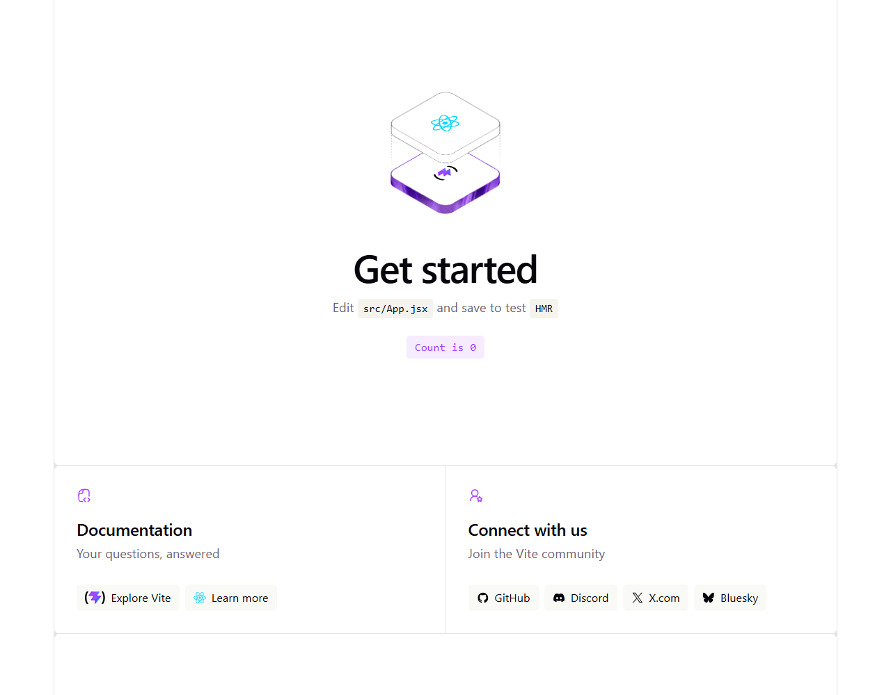 |
| `npm run dev` di `localhost:5173` | 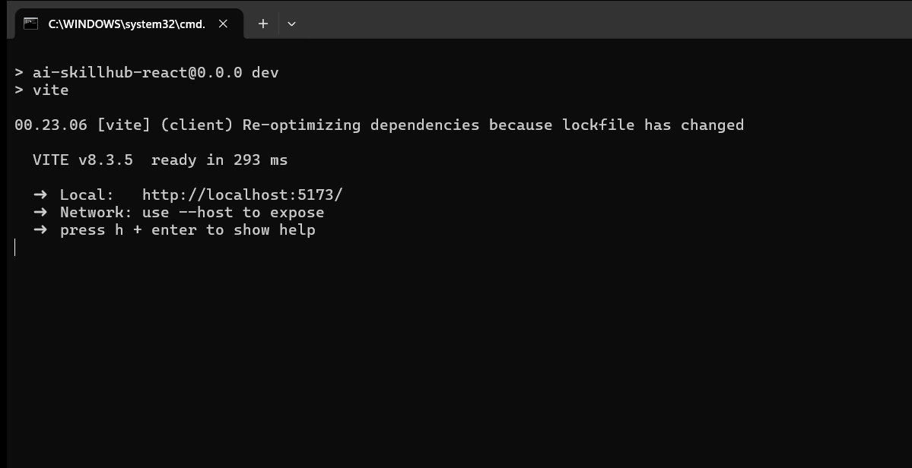 |
| Tampilan akhir (desktop) | 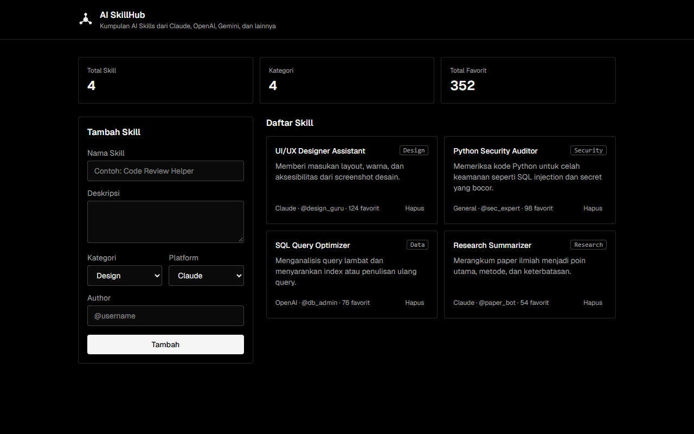 |
| Tampilan akhir (mobile) | 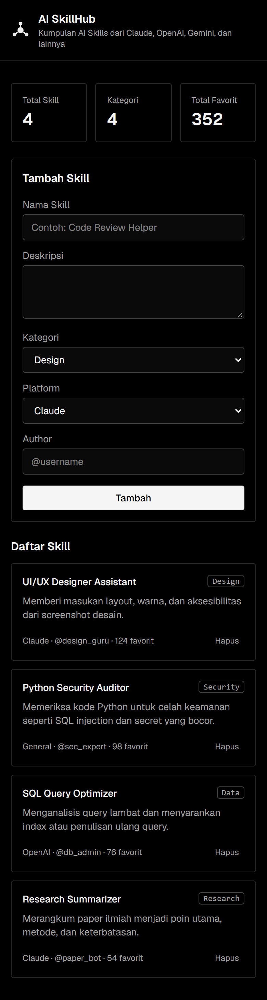 |
| Validasi form kosong |  |
| Mengisi form | 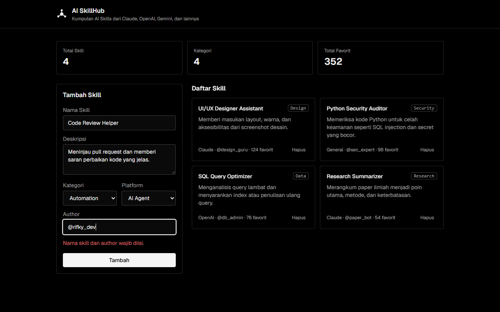 |
| Setelah klik Tambah | 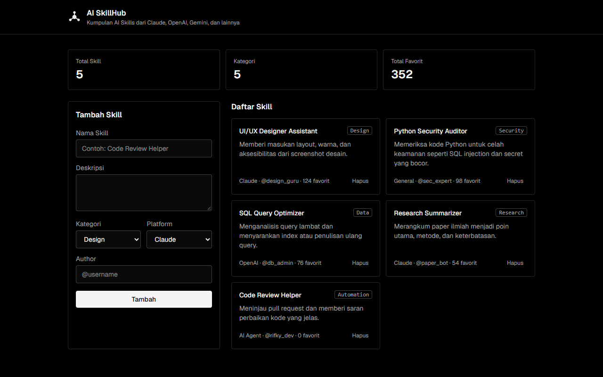 |
| Daftar kosong | 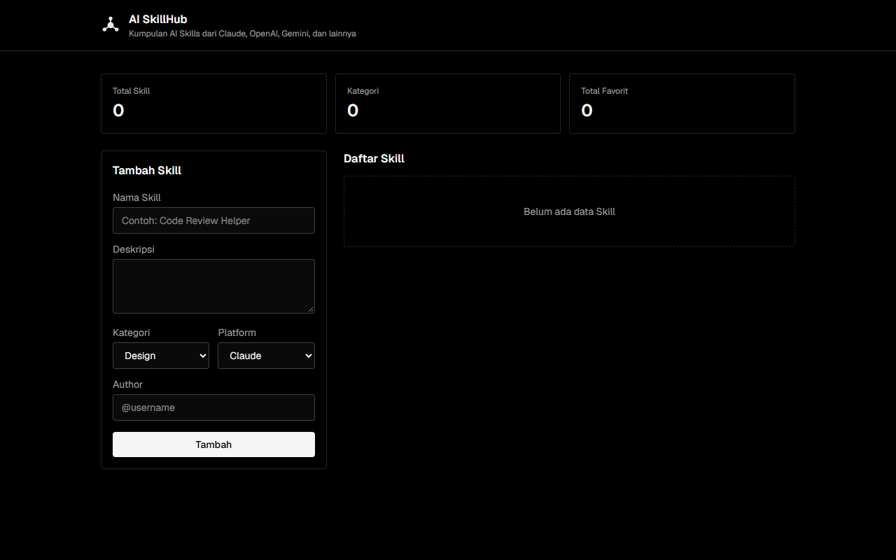 |

---

## Minggu 7: Ajax dan Konsumsi API Eksternal

Fitur baru: section **Skill Populer dari GitHub** (`src/components/GitHubSkills.jsx`) yang mengambil daftar repository AI skills dari GitHub secara asinkron menggunakan `fetch()`.

### Endpoint yang Dipakai

```
GET https://api.github.com/search/repositories?q=topic:agent-skills&sort=stars&per_page=6
```

| Parameter | Arti |
|---|---|
| `q=topic:agent-skills` | Cari repository yang diberi topik `agent-skills` |
| `sort=stars` | Urutkan dari bintang terbanyak |
| `per_page=6` | Ambil 6 repository teratas |

**Alasan memilih endpoint ini:**

1. **Sesuai tema aplikasi.** AI SkillHub adalah tempat menemukan AI skills, dan sebagian besar skill tersebut memang dipublikasikan di GitHub. Topik `agent-skills` berisi repository skill sungguhan seperti `anthropics/skills` dan `addyosmani/agent-skills`, sehingga data yang tampil relevan, bukan data contoh.
2. **Gratis dan tanpa pendaftaran.** GitHub Search API bisa dipakai tanpa token untuk membaca data publik.
3. **Mendukung CORS.** Respons GitHub mengirim header `Access-Control-Allow-Origin: *`, jadi bisa dipanggil langsung dari browser tanpa server perantara.

Batasan: tanpa token, GitHub hanya mengizinkan 10 request pencarian per menit. Jika batas ini terlewati, GitHub membalas status 403 dan aplikasi menampilkan kondisi error beserta tombol **Coba Lagi**.

### Penerapan Pola Loading, Success, dan Error

Semua logika ada di component `GitHubSkills`.

**1. Tiga state untuk menyimpan kondisi request**

```jsx
const [status, setStatus] = useState('loading') // 'loading' | 'success' | 'error'
const [repos, setRepos] = useState([])
const [errorMessage, setErrorMessage] = useState('')
```

Status awal dibuat `'loading'` karena data langsung diambil begitu halaman dibuka.

**2. Fungsi `fetchSkills()` untuk mengambil data**

- Memanggil `fetch(API_URL)` dengan `async/await`.
- `fetch` tidak otomatis gagal ketika server membalas 404 atau 403, jadi `response.ok` dicek manual. Jika `false`, fungsi melempar `Error` berisi kode statusnya.
- Jika berhasil, `data.items` disimpan ke `repos` dan status diubah menjadi `'success'`.
- Semua kegagalan (status bukan 2xx, internet putus, atau CORS) ditangkap di blok `catch`. Pesan error disimpan ke `errorMessage` dan status diubah menjadi `'error'`.

**3. `useEffect` untuk memanggil API saat halaman dibuka**

```jsx
useEffect(() => {
  fetchSkills()
}, [])
```

Array dependency kosong `[]` membuat request hanya dijalankan sekali saat component pertama kali tampil.

**4. Conditional rendering berdasarkan `status`**

| Kondisi | Yang ditampilkan |
|---|---|
| `status === 'loading'` | Kotak dengan teks "Memuat skill dari GitHub..." yang berkedip (`animate-pulse`) |
| `status === 'success'` | Daftar kartu repository memakai `repos.map()` dengan `key={repo.id}`. Tiap kartu berisi nama, deskripsi, bahasa, jumlah bintang, dan link "Buka di GitHub" |
| `status === 'error'` | Pesan "Gagal memuat data dari GitHub.", detail penyebabnya (misalnya "Server GitHub membalas dengan status 404."), dan tombol **Coba Lagi** |

**5. Interaksi: tombol Coba Lagi (`handleRetry()`)**

Tombol ini hanya muncul saat kondisi error. Ketika diklik, `handleRetry()` mengubah status kembali ke `'loading'` lalu memanggil `fetchSkills()` lagi, sehingga pengguna bisa mengulang request tanpa me-reload halaman.

### Screenshot

Kondisi error disimulasikan dengan mengalihkan request ke endpoint yang salah (`/search/repositoriez`), sehingga GitHub membalas status 404. Setelah itu endpoint dikembalikan seperti semula dan tombol **Coba Lagi** berhasil memuat data lagi.

| Kondisi | Screenshot |
|---|---|
| Loading | 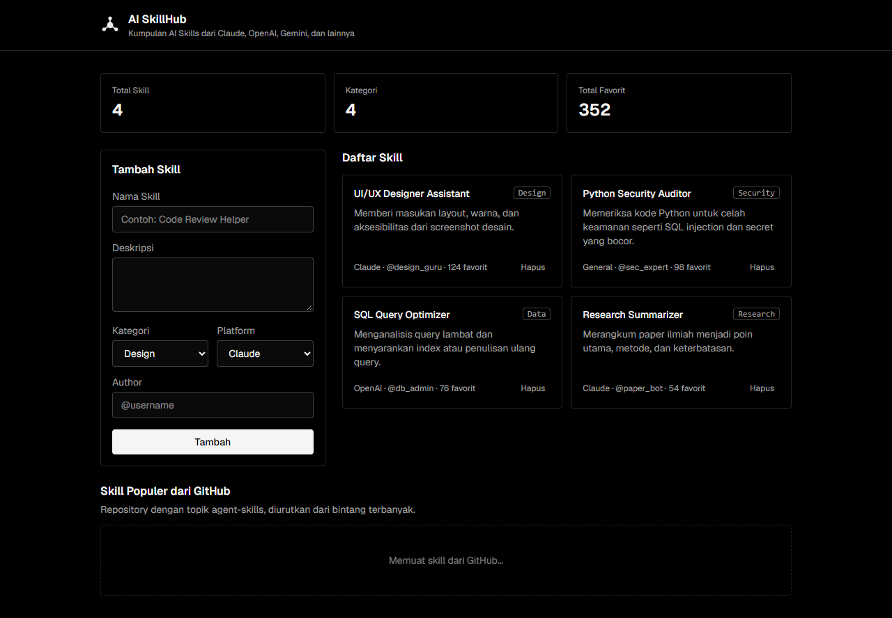 |
| Success | 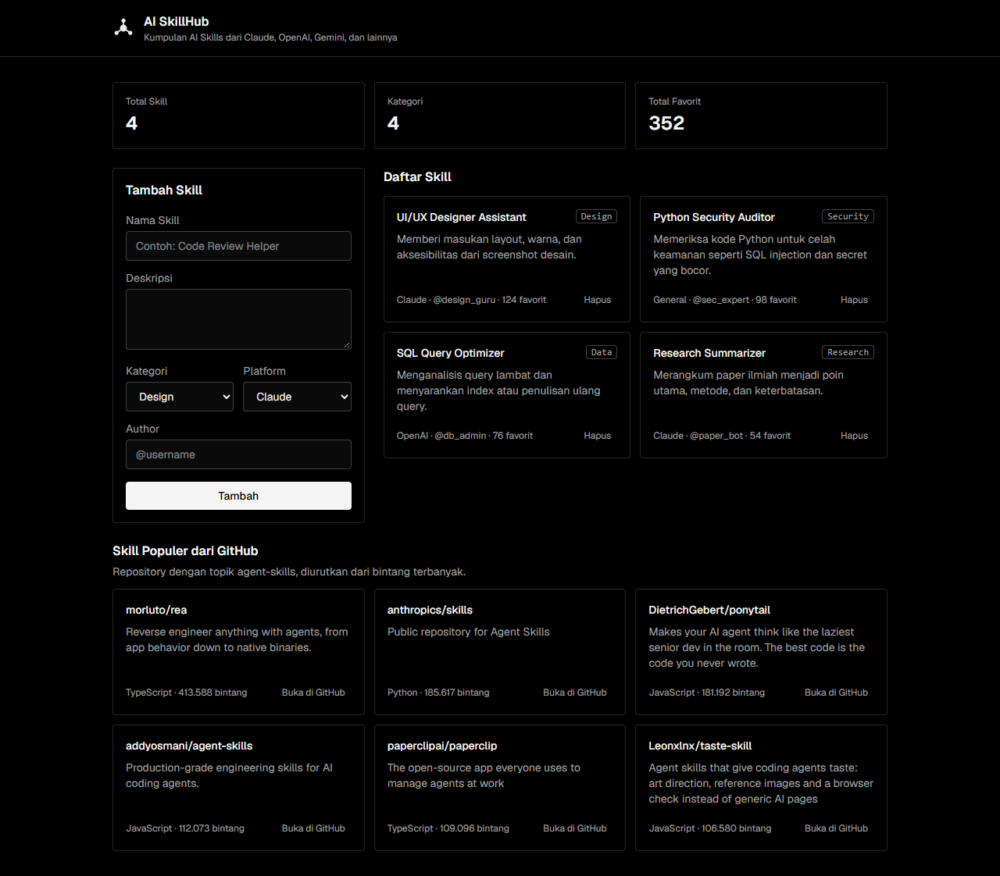 |
| Error | 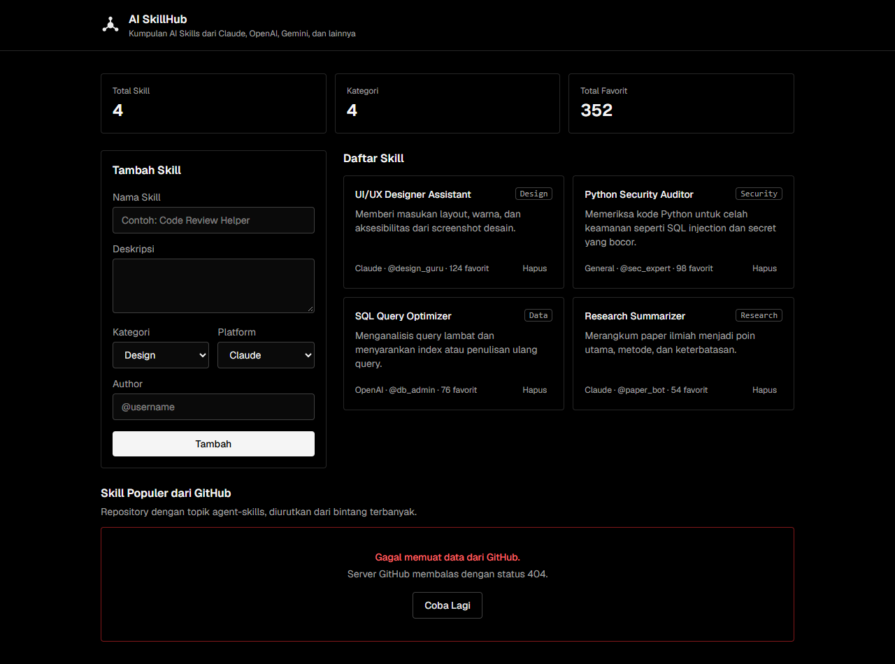 |


---

## Minggu 9: NestJS Dasar + Struktur MVC

> Bagian ini mencatat penyimpanan di memori pada Minggu 9. Implementasi saat ini memakai PostgreSQL.

### Data Utama dan Pembagian Tanggung Jawab

Entitas utama adalah **Skill**, yang mengikuti data di frontend:

| Field | Tipe | Keterangan |
|---|---|---|
| id | number | Dibuat otomatis oleh Service, tidak diterima dari form |
| name | string | Nama skill yang unik, mengabaikan kapital dan spasi di tepi |
| description | string | Kegunaan skill |
| category | string | Design, Security, Data, Writing, Research, Automation |
| platform | string | Claude, OpenAI, Gemini, AI Agent, General |
| author | string | Nama atau handle kontributor |
| favs | number | Jumlah favorit, integer >= 0 |

- **Model:** `Skill` menyatakan bentuk data. `SkillsService` mengelola array di memori dan aturan bisnis, termasuk CRUD serta pengecekan nama duplikat.
- **View:** React menampilkan data dan menerima input. Tampilan tetap di `src/components`; tidak perlu membuat template HTML di backend karena API mengirim JSON ke React.
- **Controller:** `SkillsController` menerima HTTP request dan meneruskannya ke Service. Service di-inject lewat constructor, bukan dibuat dengan `new SkillsService()`.
- **DTO:** `CreateSkillDto` dan `UpdateSkillDto` memvalidasi payload sebelum diteruskan ke Service.
- **Module:** `SkillsModule` mendaftarkan Controller dan Service, kemudian diimpor oleh `AppModule`.

Alur: **React -> request HTTP -> DTO/ValidationPipe -> Controller -> Service -> array Skill -> JSON -> React**.
Secara teknis pipe memvalidasi payload sebelum method Controller dijalankan.

Empat skill awal berasal dari tugas React sebelumnya. ID baru dibuat berurutan dan ID yang dihapus tidak digunakan ulang. Data tidak disimpan ke database; restart backend mengembalikan empat data awal.

### Scaffold Melalui Nest CLI

Backend dan resource dibuat menggunakan perintah:

```bash
npx @nestjs/cli@11 new backend --package-manager npm --skip-git --skip-install --strict
cd backend
npx @nestjs/cli@11 generate resource skills --type rest --crud --no-spec
npm install @nestjs/swagger@11 class-validator class-transformer
```

Setelah scaffold, Entity, DTO, Controller, dan Service disesuaikan dengan data Skill.

### Endpoint CRUD

| Method | Endpoint | Fungsi Service | Berhasil |
|---|---|---|---|
| GET | /api/skills | findAll() | 200, array skill |
| GET | /api/skills/:id | findOne(id) | 200, satu skill |
| POST | /api/skills | create(dto) | 201, skill baru |
| PATCH | /api/skills/:id | update(id, dto) | 200, skill hasil perubahan |
| DELETE | /api/skills/:id | remove(id) | 200, skill yang dihapus |

Contoh POST:

```json
{
  "name": "Code Review Helper",
  "description": "Meninjau kode dan memberikan saran perbaikan.",
  "category": "Automation",
  "platform": "Claude",
  "author": "@rifky",
  "favs": 0
}
```

Contoh PATCH (cukup kirim field yang ingin diubah):

```json
{
  "name": "Code Review Updated",
  "favs": 12
}
```

### DTO dan Validasi Global

`main.ts` mengaktifkan `ValidationPipe` secara global dengan `whitelist: true`, `forbidNonWhitelisted: true`, dan `transform: true`. Field asing seperti `id` dari client ditolak dengan 400.

Aturan di `CreateSkillDto`:

- `@IsString()`: nama, deskripsi, kategori, platform, dan author harus teks.
- `@MinLength()` dan `@MaxLength()`: nama 3-100, deskripsi 10-500, author 2-50 karakter.
- `@IsIn()`: kategori dan platform hanya menerima pilihan yang tersedia.
- `@IsInt()` dan `@Min(0)`: favorit wajib integer dan tidak boleh negatif.
- `@Transform()`: spasi di tepi nama, deskripsi, dan author dibuang sebelum validasi.

`UpdateSkillDto` memakai `PartialType(CreateSkillDto)` dari `@nestjs/swagger`, sehingga field boleh tidak dikirim tetapi aturan Create tetap berlaku pada field yang dikirim. Nilai `null` tetap ditolak. Parameter ID diproses menggunakan `ParseIntPipe`, sehingga ID bukan integer menghasilkan 400.

### Penanganan Error

| Penyebab | Exception | HTTP |
|---|---|---|
| Payload/ID tidak valid | BadRequestException dari ValidationPipe/ParseIntPipe | 400 |
| ID tidak ada (GET, PATCH, DELETE) | NotFoundException di findOne() | 404 |
| Nama sudah dipakai (POST/PATCH) | ConflictException di checkDuplicate() | 409 |

### REST Client Terpasang: Swagger UI

Swagger terpasang di backend melalui `@nestjs/swagger`, sehingga pengujian bisa dilakukan langsung di browser tanpa Postman.

1. Jalankan backend lalu buka http://localhost:3000/docs.
2. Buka endpoint, klik **Try it out**, isi ID/body bila diperlukan.
3. Klik **Execute**.
4. Periksa **Curl**, **Request URL**, **Server response**, kode status, dan response body.

Seluruh endpoint diuji melalui Swagger sebelum alur integrasi React diuji. Screenshot merupakan request dan respons server sungguhan.

### Integrasi React

`src/services/skillsApi.js` mengirim request dengan `fetch`. `App.jsx` mengambil daftar dari backend saat halaman dibuka. Form `SkillForm` memanggil POST ketika menambah dan PATCH ketika menyimpan perubahan. Tombol Hapus memanggil DELETE.

State React baru diperbarui setelah server berhasil. Saat request berlangsung, tombol dinonaktifkan agar tidak terkirim ganda. Jika gagal, pesan error tampil dan input form tetap ada. Nama duplikat dari backend juga tampil di form.

Alur yang diuji: **Tambah -> Ubah -> reload browser (perubahan tetap ada) -> Hapus**. Reload browser tidak mereset array backend; restart proses backend meresetnya.

### Verifikasi

Dari root repository:

```bash
npm run build
npm run lint
cd backend
npm run build
npm run lint
npm run test:e2e -- --runInBand
```

Pengujian otomatis mencakup 21 kasus: CRUD, nilai yang benar-benar berubah, ID tidak digunakan ulang, 404, duplikat POST/PATCH, field asing, panjang teks, nilai kategori/platform, tipe favorit, null, dan ID bukan integer.

### Screenshot Request dan Response

| Tahap | Bukti |
|---|---|
| GET daftar - 200 | [Screenshot](docs/screenshots/minggu-9/01-get-list.jpg) |
| POST tambah - 201 | [Screenshot](docs/screenshots/minggu-9/02-post-create.jpg) |
| GET detail - 200 | [Screenshot](docs/screenshots/minggu-9/03-get-detail.jpg) |
| PATCH ubah - 200 | [Screenshot](docs/screenshots/minggu-9/04-patch-update.jpg) |
| DELETE - 200 | [Screenshot](docs/screenshots/minggu-9/05-delete.jpg) |
| Nama duplikat - 409 | [Screenshot](docs/screenshots/minggu-9/06-error-409.jpg) |
| Data tidak ditemukan - 404 | [Screenshot](docs/screenshots/minggu-9/07-error-404.jpg) |
| Validasi gagal - 400 | [Screenshot](docs/screenshots/minggu-9/08-error-400.jpg) |
| React setelah tambah | [Screenshot](docs/screenshots/minggu-9/09-react-create.jpg) |
| React setelah ubah dan reload | [Screenshot](docs/screenshots/minggu-9/10-react-update-reload.jpg) |
| React setelah hapus | [Screenshot](docs/screenshots/minggu-9/11-react-delete.jpg) |
| React pada mobile | [Screenshot](docs/screenshots/minggu-9/12-react-mobile.jpg) |

<details>
<summary>Pratinjau POST dan alur React</summary>

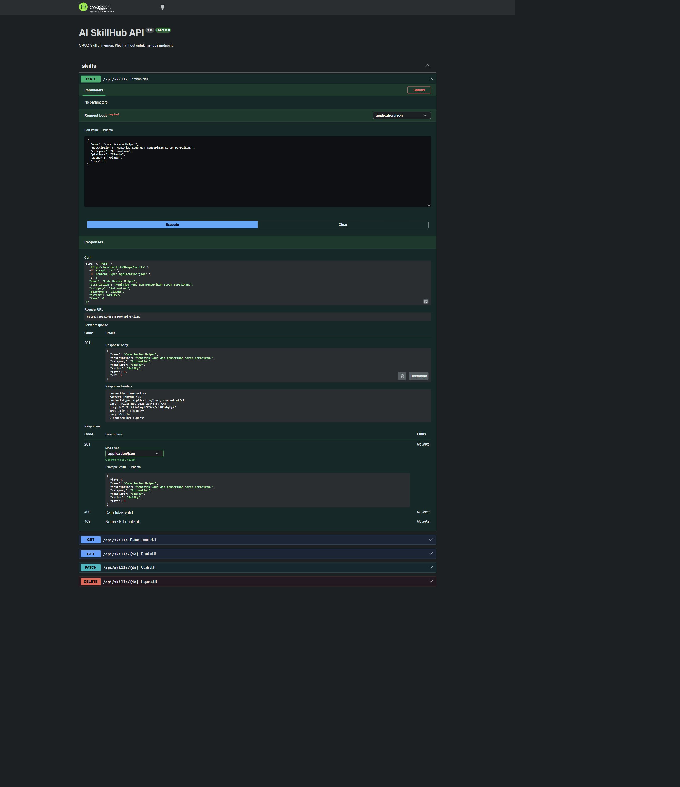

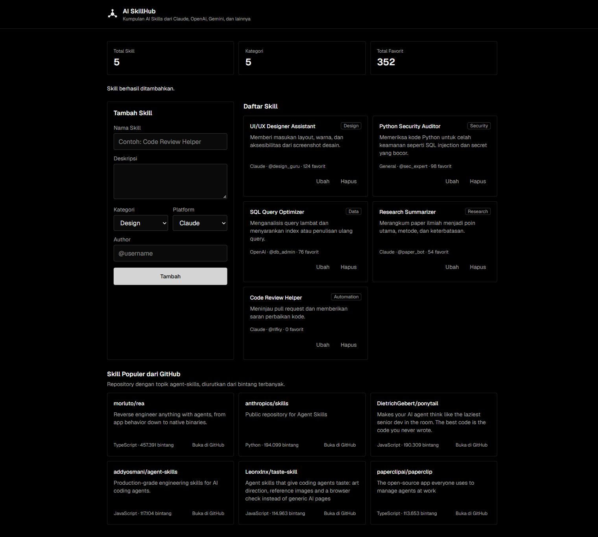

</details>

Referensi implementasi: [Nest CLI resource](https://docs.nestjs.com/recipes/crud-generator), [validasi DTO](https://docs.nestjs.com/techniques/validation), dan [Swagger UI](https://docs.nestjs.com/openapi/introduction).

---

## Minggu 10: REST API + PostgreSQL + Prisma

Data **Skill** sekarang tersimpan di PostgreSQL lokal pada database `ai_skillhub`. Modelnya ada di `backend/prisma/schema.prisma`. Migrasi awal membuat tabel `Skill` dan memasukkan empat skill dari Minggu 9. Kolom internal `normalizedName` memiliki indeks unik sehingga nama dengan kapitalisasi berbeda tetap dianggap duplikat.

`PrismaModule` menyediakan `PrismaService` untuk `SkillsService`. Operasi CRUD memakai `create`, `findMany`, `findUnique`, `update`, dan `delete` dari Prisma Client. Endpoint dan format respons tetap sama.

Pengujian API membuat dan mengubah satu skill, menghentikan NestJS, lalu memulai proses baru. GET masih mengembalikan nilai yang sudah diubah. Setelah DELETE, GET untuk ID yang sama mengembalikan 404. Alur tambah, ubah, dan hapus juga diuji melalui React. Sebanyak 23 tes integrasi lolos pada database tes terpisah.

| Tahap | Screenshot |
|---|---|
| Database PostgreSQL dan tabel Skill | [Lihat bukti](docs/screenshots/minggu-10/01-postgresql.jpg) |
| Model Prisma dan PrismaService | [Lihat bukti](docs/screenshots/minggu-10/02-model-provider.jpg) |
| Hasil `npx prisma migrate dev` | [Lihat bukti](docs/screenshots/minggu-10/03-migrasi.jpg) |
| CRUD dan persistensi setelah restart NestJS | [Lihat bukti](docs/screenshots/minggu-10/04-crud-restart.jpg) |
| Tampilan desktop | [Lihat screenshot](docs/screenshots/minggu-10/05-desktop.jpg) |
| Tampilan mobile (390 px) | [Lihat screenshot](docs/screenshots/minggu-10/06-mobile.jpg) |

---

## JWT Auth dan Keamanan Dasar

Migrasi Prisma menambahkan tabel User dengan email unik dan passwordHash. Setelah menjalankan migrasi, buka React dan klik **Buat akun**, lalu masuk dengan akun tersebut. POST /api/auth/register membuat akun, dan POST /api/auth/login mengembalikan accessToken.

AuthService memakai bcrypt saat menyimpan dan memeriksa kata sandi. Seluruh endpoint /api/skills dilindungi JwtAuthGuard, yang memeriksa tanda tangan serta masa berlaku token. React menyimpan accessToken di memori dan menambahkannya ke header Authorization. Memuat ulang halaman mengharuskan pengguna masuk kembali.

Untuk menguji di Swagger, jalankan register dan login, lalu masukkan accessToken melalui **Authorize** sebelum mencoba endpoint Skill. Helmet menambahkan header keamanan ke respons. Query aplikasi menggunakan metode Prisma dengan nilai input sebagai parameter untuk mengurangi risiko SQL injection.

Konfigurasi JWT_SECRET dijelaskan di [panduan backend](backend/README.md). Bukti uji dan penjelasan ada di [laporan tugas](docs/Laporan-JWT-AI-SkillHub.docx).
