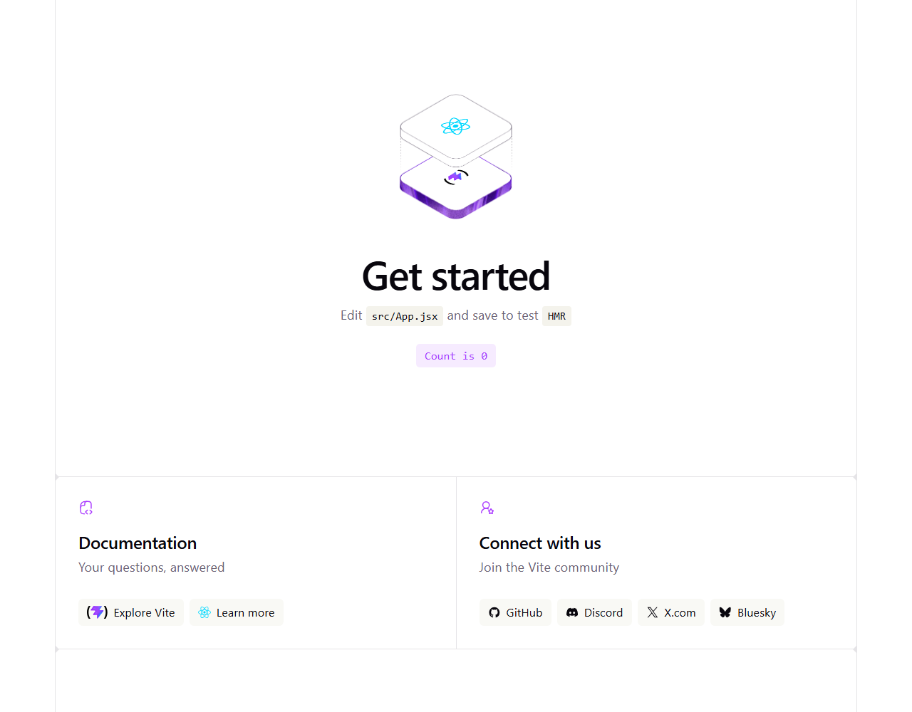
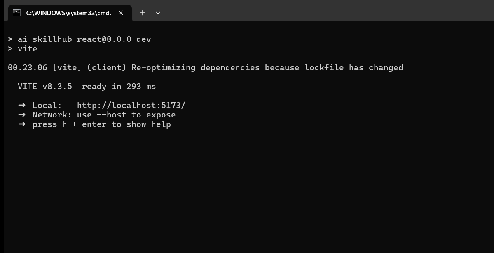
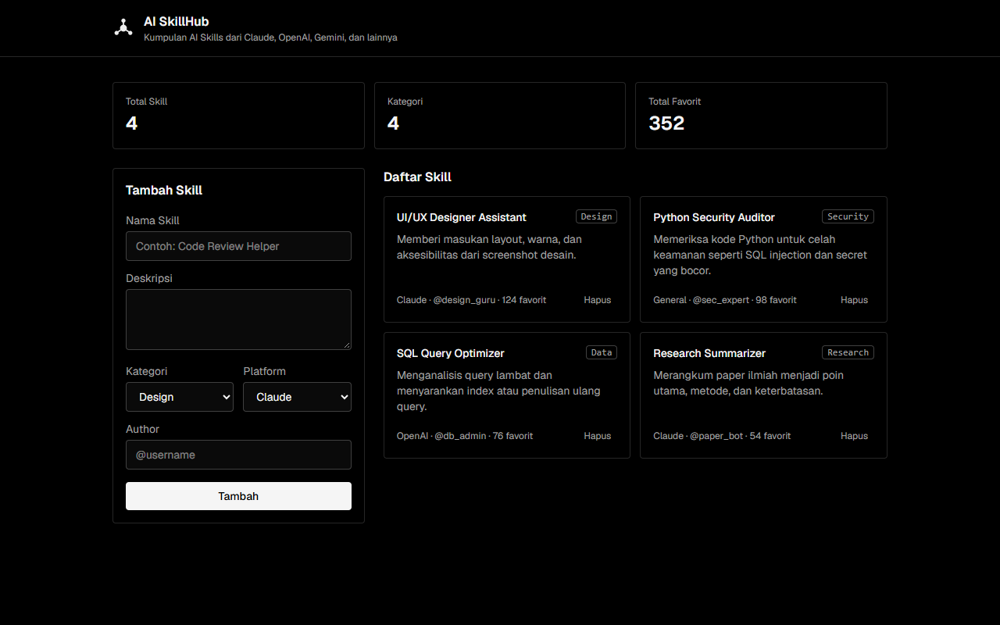
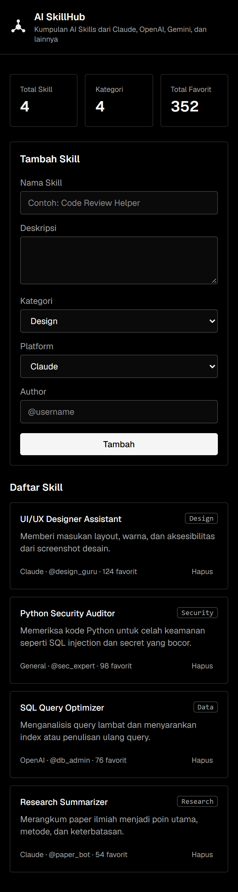
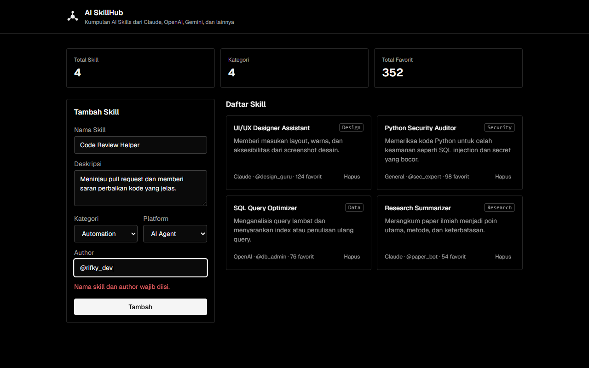
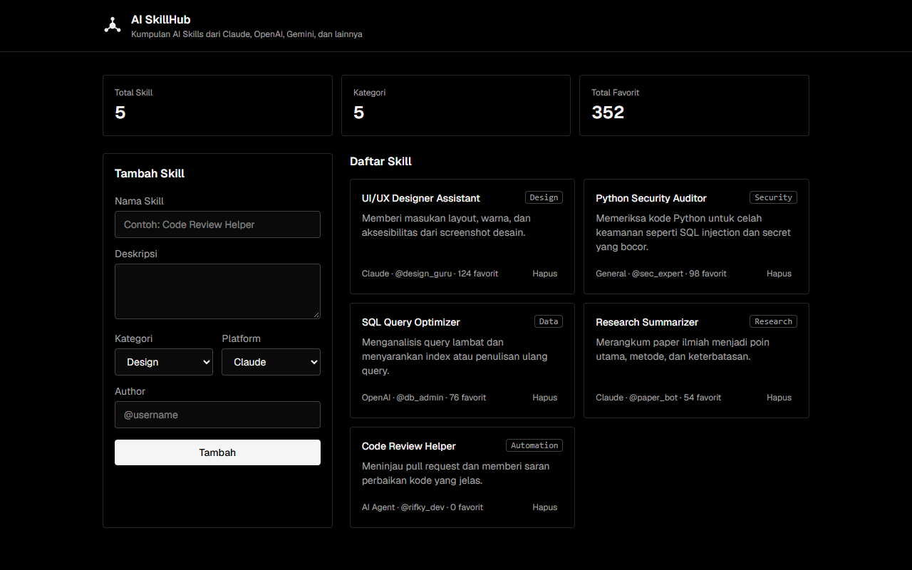
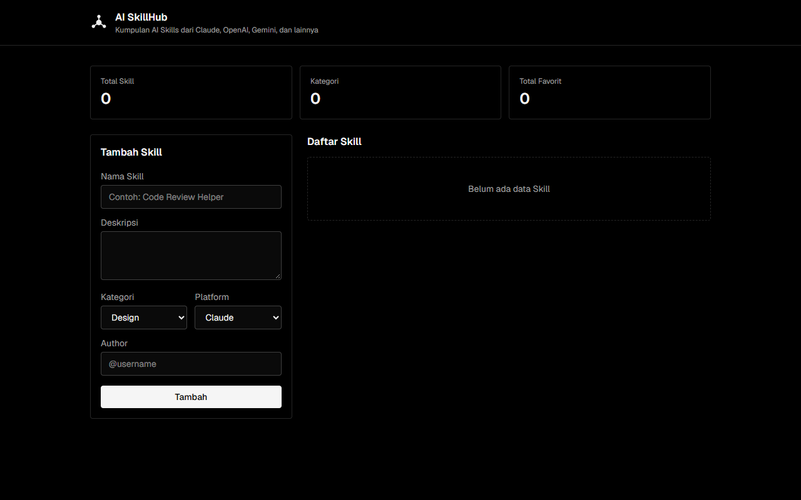
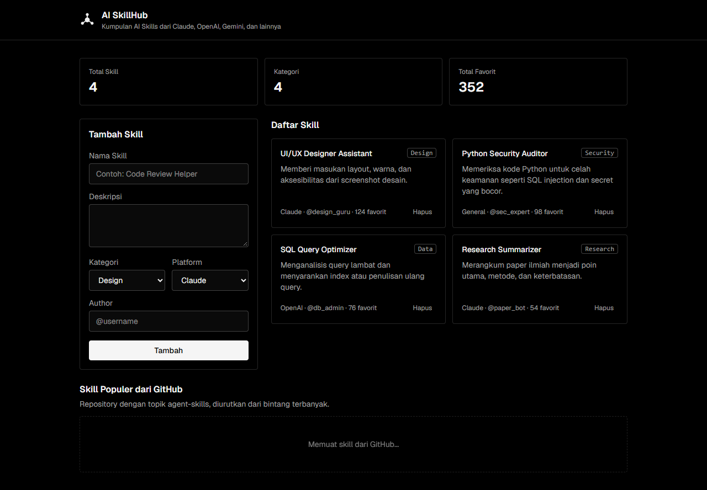
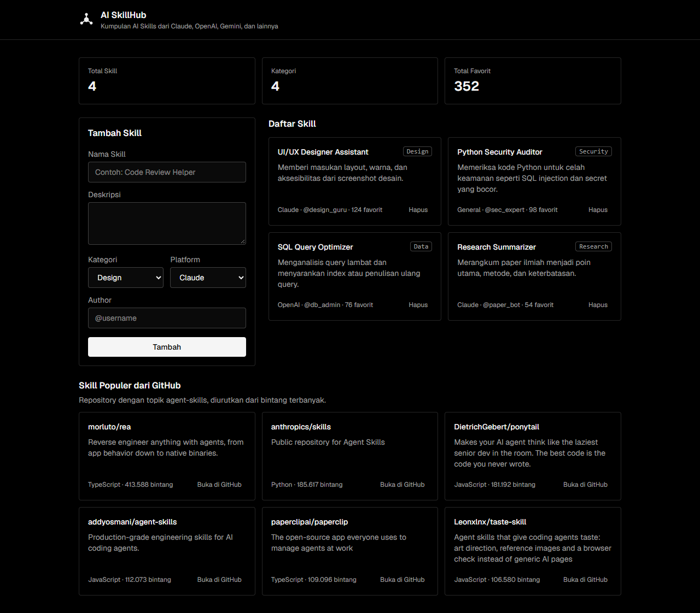
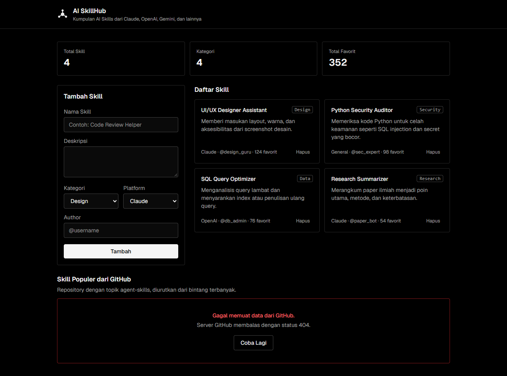

# AI SkillHub (React)

**Nama:** Rifky Albuchori  
**NIM:** 103022400126  
**Kelas:** SE-48-04  
**Studi Kasus:** AI SkillHub (Community-driven AI Skills Repository)

---

## Deskripsi

AI SkillHub adalah aplikasi untuk menemukan, menyimpan, dan membagikan *AI Skills* dari berbagai ekosistem AI (Claude, OpenAI, Gemini, hingga AI Agents). Repository ini adalah frontend React yang akan terus dikembangkan sampai pekan ke-14 dan disambungkan ke backend/API pada pekan ke-11.

**Entitas utama:** Skill, dengan atribut `name`, `description`, `category`, `platform`, `author`, dan `favs`.

## Teknologi

- [React 19](https://react.dev/) dengan [Vite](https://vite.dev/)
- [Tailwind CSS v4](https://tailwindcss.com/) melalui plugin `@tailwindcss/vite`
- Font [Geist](https://fonts.google.com/specimen/Geist) dari Google Fonts

## Cara Menjalankan

```bash
npm install
npm run dev
```

Buka `http://localhost:5173` di browser.

> Jika PowerShell menolak menjalankan `npm` karena *execution policy*, gunakan `npm.cmd run dev` atau jalankan dari Git Bash/CMD.

## Struktur Folder

```
ai-skillhub-react/
├── index.html
├── public/
│   └── logo.svg
├── src/
│   ├── main.jsx
│   ├── App.jsx
│   ├── index.css
│   └── components/
│       ├── Header.jsx
│       ├── SkillSummary.jsx
│       ├── SkillForm.jsx
│       ├── SkillList.jsx
│       ├── SkillCard.jsx
│       └── GitHubSkills.jsx
└── docs/
    └── screenshots/
        └── minggu-7/
```

---

## Minggu 6: React Dasar

### Component

| Component | Props | Fungsi |
|---|---|---|
| `Header` | `title`, `subtitle` | Logo dan judul aplikasi |
| `SkillSummary` | `totalSkill`, `totalKategori`, `totalFavorit` | Ringkasan jumlah data skill |
| `SkillForm` | `categories`, `platforms`, `onAdd` | Form tambah skill (controlled component) |
| `SkillList` | `skills`, `onDelete` | Daftar skill dan pesan saat daftar kosong |
| `SkillCard` | `name`, `description`, `category`, `platform`, `author`, `favs`, `onDelete` | Kartu untuk satu skill |
| `GitHubSkills` | - | Daftar skill populer dari GitHub Search API (Minggu 7) |

### Interaktivitas

| Requirement | Penerapan |
|---|---|
| State array dan render list | `App.jsx` menyimpan daftar skill dengan `useState(dataAwal)`. `SkillList` menampilkannya dengan `skills.map()` dan `key={skill.id}`. |
| Form input (controlled component) | Setiap input di `SkillForm` memakai `value={form...}` dan `onChange={handleChange}`. Tombol **Tambah** memanggil `onAdd`, lalu `App` menambah item baru dengan `setSkills([...skills, skillBaru])`. Nama skill dan author wajib diisi. |
| Conditional rendering | Jika `skills.length === 0`, `SkillList` menampilkan teks **"Belum ada data Skill"**. Tombol **Hapus** di tiap kartu bisa dipakai untuk mengosongkan daftar. |

### Screenshot

| Tahap | Screenshot |
|---|---|
| Tampilan awal setelah instalasi |  |
| `npm run dev` di `localhost:5173` |  |
| Tampilan akhir (desktop) |  |
| Tampilan akhir (mobile) |  |
| Validasi form kosong |  |
| Mengisi form |  |
| Setelah klik Tambah |  |
| Daftar kosong |  |

---

## Minggu 7: Ajax dan Konsumsi API Eksternal

Fitur baru: section **Skill Populer dari GitHub** (`src/components/GitHubSkills.jsx`) yang mengambil daftar repository AI skills dari GitHub secara asinkron menggunakan `fetch()`.

### Endpoint yang Dipakai

```
GET https://api.github.com/search/repositories?q=topic:agent-skills&sort=stars&per_page=6
```

| Parameter | Arti |
|---|---|
| `q=topic:agent-skills` | Cari repository yang diberi topik `agent-skills` |
| `sort=stars` | Urutkan dari bintang terbanyak |
| `per_page=6` | Ambil 6 repository teratas |

**Alasan memilih endpoint ini:**

1. **Sesuai tema aplikasi.** AI SkillHub adalah tempat menemukan AI skills, dan sebagian besar skill tersebut memang dipublikasikan di GitHub. Topik `agent-skills` berisi repository skill sungguhan seperti `anthropics/skills` dan `addyosmani/agent-skills`, sehingga data yang tampil relevan, bukan data contoh.
2. **Gratis dan tanpa pendaftaran.** GitHub Search API bisa dipakai tanpa token untuk membaca data publik.
3. **Mendukung CORS.** Respons GitHub mengirim header `Access-Control-Allow-Origin: *`, jadi bisa dipanggil langsung dari browser tanpa server perantara.

Batasan: tanpa token, GitHub hanya mengizinkan 10 request pencarian per menit. Jika batas ini terlewati, GitHub membalas status 403 dan aplikasi menampilkan kondisi error beserta tombol **Coba Lagi**.

### Penerapan Pola Loading, Success, dan Error

Semua logika ada di component `GitHubSkills`.

**1. Tiga state untuk menyimpan kondisi request**

```jsx
const [status, setStatus] = useState('loading') // 'loading' | 'success' | 'error'
const [repos, setRepos] = useState([])
const [errorMessage, setErrorMessage] = useState('')
```

Status awal dibuat `'loading'` karena data langsung diambil begitu halaman dibuka.

**2. Fungsi `fetchSkills()` untuk mengambil data**

- Memanggil `fetch(API_URL)` dengan `async/await`.
- `fetch` tidak otomatis gagal ketika server membalas 404 atau 403, jadi `response.ok` dicek manual. Jika `false`, fungsi melempar `Error` berisi kode statusnya.
- Jika berhasil, `data.items` disimpan ke `repos` dan status diubah menjadi `'success'`.
- Semua kegagalan (status bukan 2xx, internet putus, atau CORS) ditangkap di blok `catch`. Pesan error disimpan ke `errorMessage` dan status diubah menjadi `'error'`.

**3. `useEffect` untuk memanggil API saat halaman dibuka**

```jsx
useEffect(() => {
  fetchSkills()
}, [])
```

Array dependency kosong `[]` membuat request hanya dijalankan sekali saat component pertama kali tampil.

**4. Conditional rendering berdasarkan `status`**

| Kondisi | Yang ditampilkan |
|---|---|
| `status === 'loading'` | Kotak dengan teks "Memuat skill dari GitHub..." yang berkedip (`animate-pulse`) |
| `status === 'success'` | Daftar kartu repository memakai `repos.map()` dengan `key={repo.id}`. Tiap kartu berisi nama, deskripsi, bahasa, jumlah bintang, dan link "Buka di GitHub" |
| `status === 'error'` | Pesan "Gagal memuat data dari GitHub.", detail penyebabnya (misalnya "Server GitHub membalas dengan status 404."), dan tombol **Coba Lagi** |

**5. Interaksi: tombol Coba Lagi (`handleRetry()`)**

Tombol ini hanya muncul saat kondisi error. Ketika diklik, `handleRetry()` mengubah status kembali ke `'loading'` lalu memanggil `fetchSkills()` lagi, sehingga pengguna bisa mengulang request tanpa me-reload halaman.

### Screenshot

Kondisi error disimulasikan dengan mengalihkan request ke endpoint yang salah (`/search/repositoriez`), sehingga GitHub membalas status 404. Setelah itu endpoint dikembalikan seperti semula dan tombol **Coba Lagi** berhasil memuat data lagi.

| Kondisi | Screenshot |
|---|---|
| Loading |  |
| Success |  |
| Error |  |
